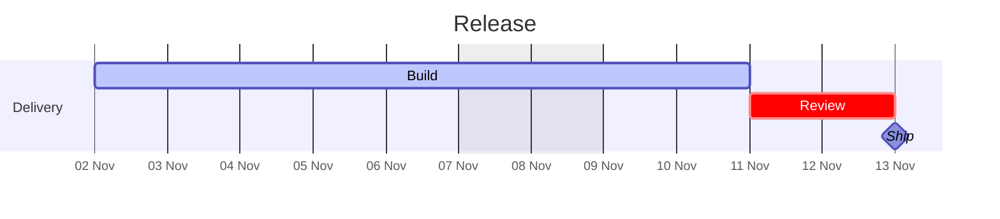

# Gantt charts

Mermaid Gantt charts use the shared native renderer. Both Markdown fences and
standalone `.mmd` / `.mermaid` files work, including pager/watch mode and
`--show-mermaid-source`. The canvas is transparent and labels follow terminal
cell size. See [the fixture](../tests/fixtures/gantt.md) for examples.

Supported scheduling:

- Strict ISO dates, explicit end dates, and integral day/week/month/year
  durations (`d`, `w`, `M`, `y`). Months and years respect the calendar.
- Omitted starts continue from the previous task's end, across sections too.
- `after ID` or multiple dependencies, including forward references. IDs are
  case sensitive; unknown, duplicate and cyclic references retain source.
- Titles, sections, combined `done`/`active`/`crit`/`milestone` tags and accented labels.
- Weekend exclusions and explicit ISO holidays, including repeated `excludes`
  lines. Explicit end dates stay exact. Trailing excluded days are omitted from
  the visible bar while dependencies use the next included day. Excluded dates
  are not shaded as separate columns.
- `axisFormat` supports `%Y`, `%y`, `%m`, `%d`, `%e`, `%b`, `%%` and literal text.
  Month abbreviations are English; tick spacing adjusts to label width.
- `todayMarker off`; no current-date marker is drawn by default.

Other date formats, sub-day or fractional durations, `until`, custom tick
intervals, weekday exclusions, custom weekends, `includes`, inclusive end dates,
vertical markers, click handlers and front matter retain the complete source.
The first task needs a date or a resolvable dependency; rendering never guesses
today's date. Lowercase `m` means minutes and is unsupported; uppercase `M`
means calendar months.

The shared library permits 128 tasks, 16 sections, 128 excluded-date entries,
36,600 days per task/chart, 128 bytes per axis format and 1 KiB per label/title.
The existing 16 KiB Mermaid source limit, worker deadline/memory limits,
one-million-pixel raster cap and 64 MiB output budget still apply. Large charts
use the existing vertical bands and may shrink at the raster cap. Parsing and
scheduling stay in the worker. The cache and plain/source exports are unchanged.

The backend uses integer dates and iterative dependency resolution. Calendar
work is bounded without scanning every day in a long schedule. No date library,
JavaScript runtime or additional helper process is introduced.

## Measurements

Measured on 2026-11-05 with release builds, thin LTO/one codegen unit, Rust 1.99.0,
Apple M2 Pro / 16 GiB and macOS 26.4.1. Medians of five fresh CLI processes after
one warm-up per build, alternating builds, with a drained 100×40 PTY, 10×20-pixel
cells, 80 content columns and two-column margins. Times include startup, worker,
encoding and PTY output; they exclude emulator painting and scrollback storage.
Builds and tests finished before timing. Inputs and raw results remain external;
the fixed [performance baseline](performance-baseline.md) is unchanged.

| Unchanged case | Before | Gantt build | Peak RSS before → after |
| --- | ---: | ---: | ---: |
| Mixed Markdown, 10 MiB | 938.94 ms | 949.15 ms | 58.36 → 58.31 MiB |
| 1,000 equations | 388.27 ms | 386.16 ms | 11.55 → 11.50 MiB |
| 13 Mermaid diagrams | 45.92 ms | 45.18 ms | 12.78 → 12.58 MiB |
| Dense flowchart | 262.56 ms | 261.25 ms | 19.98 → 19.30 MiB |
| Four SGF boards | 9.61 ms | 10.03 ms | 7.88 → 7.81 MiB |
| Local SVG | 4.28 ms | 4.40 ms | 4.33 → 4.33 MiB |

Thirty-two existing terminal/export cases remain byte-identical, including both
themes and source/text exports. Small timing differences are observations, not
claimed speedups. The binary grows from 17,062,336 to 17,095,504 bytes: 32.4 KiB,
with no additional dependencies.

| Gantt case | Previous code fallback | Native rendering | Peak RSS | Output |
| --- | ---: | ---: | ---: | ---: |
| Three-chart fixture | 4.37 ms | 20.15 ms | 10.59 MiB | 66,683 bytes |
| 128 tasks | 3.68 ms | 31.83 ms | 18.64 MiB | 176,014 bytes / four bands |
| Long span, 25,000 working days | 3.27 ms | 13.14 ms | 9.36 MiB | 8,143 bytes |
| 100 repeated charts | 4.66 ms | 43.31 ms | 9.52 MiB | 1,612,806 bytes |
| 40 unique charts | 4.29 ms | 66.64 ms | 13.41 MiB | 513,346 bytes |

The last case renders 32 charts and retains source for eight, as required by
the existing request budget. RSS above is the `wait4` process statistic, not
simultaneous CLI/worker memory. A separate three-sample run with process-tree
sampling observed combined peaks of 14.42 MiB for 100 repeated charts and
23.27 MiB for 40 unique charts. Sampling can miss short-lived peaks and affects
latency; those timings are not used above.

Reproduce with `bench/generate.py` and `bench/run.py` using an external work
directory prepared as described in the baseline. Select `--renderer
mdviewer/terminal-mermaid --corpus 'mermaid-gantt-*.md'` and
`--diagram-tiles mermaid-gantt-tasks-128.md=4` at these cell dimensions.
Use `--mermaid-mode off` to measure the disabled path; use `--process-tree` in a
separate run for sampled combined memory, because sampling affects short timings.
